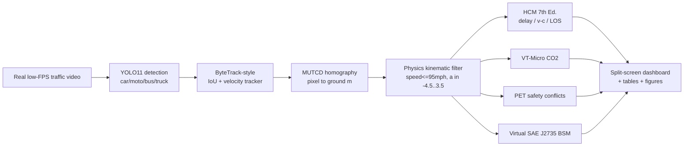
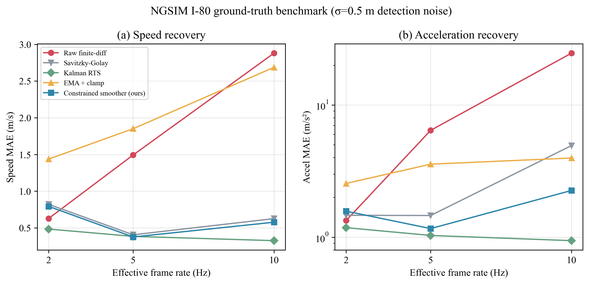
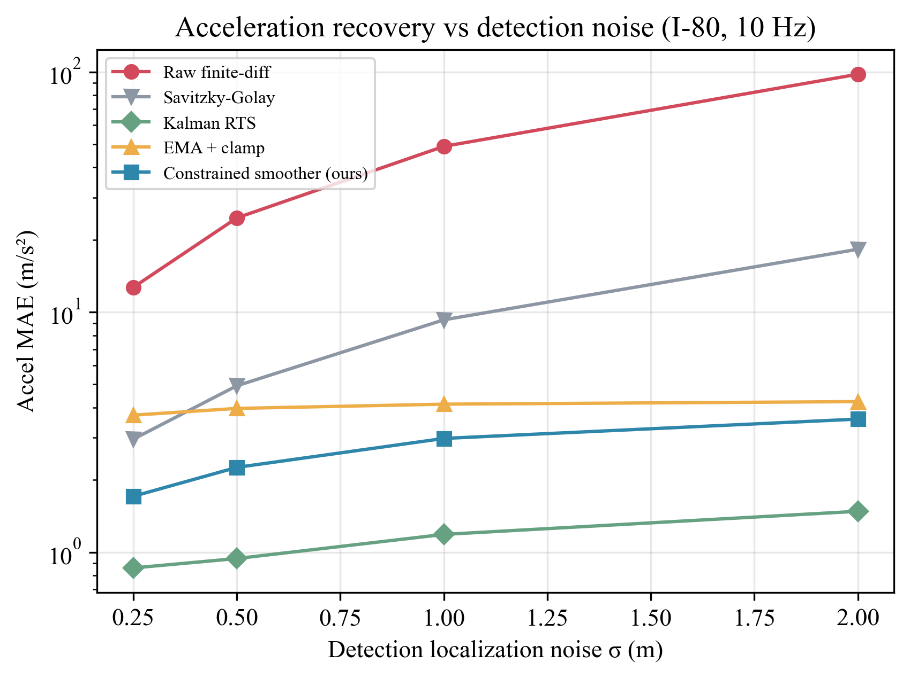
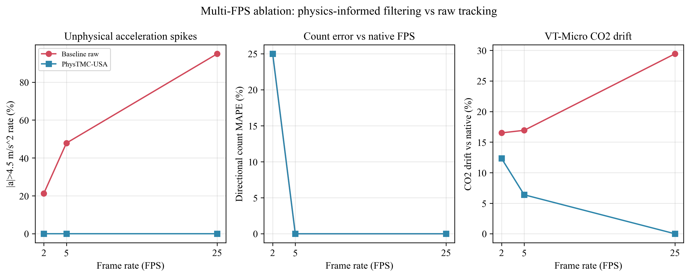
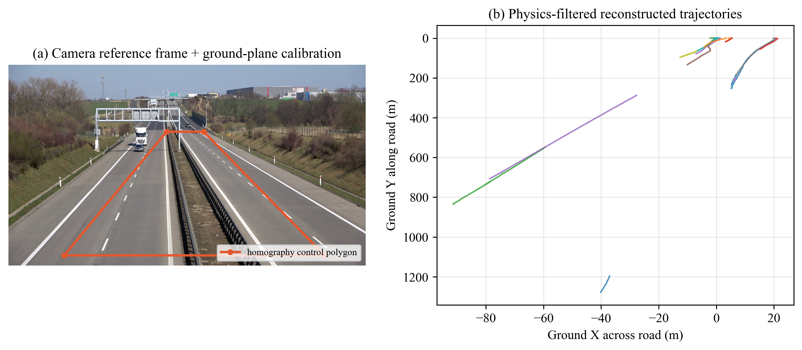
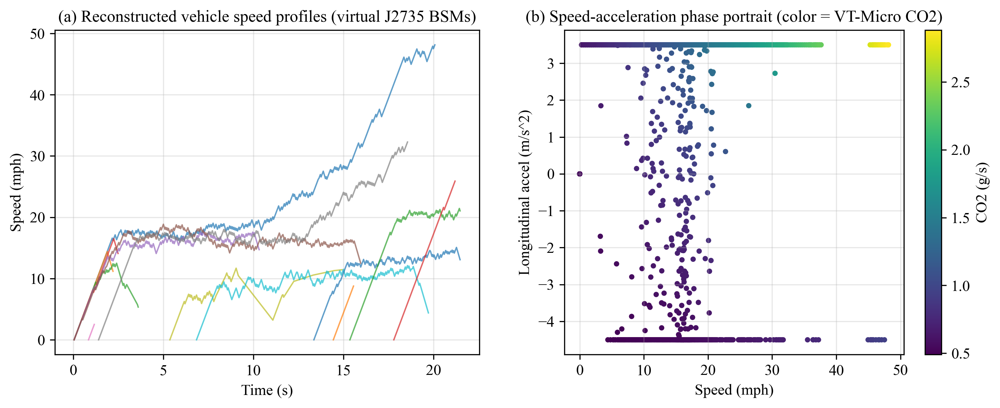

# PhysTMC-USA

**Physics-Informed Multi-Object Trajectory Reconstruction and Automated
HCM/Emissions Auditing from Legacy Low-Frame-Rate Traffic Cameras**

Turn a 2–5 FPS traffic camera into a digital-twin sensor: detect and track vehicles,
reconstruct physically-plausible ground trajectories, and auto-audit HCM 7th Edition
level-of-service, VT-Micro CO₂, surrogate safety (PET), and virtual SAE J2735 BSM
telemetry.

> **Honest data provenance.** This runs on a **real, publicly distributed overhead
> highway-traffic recording** (Roboflow `supervision` example clip; 4K, 25 FPS,
> 538 frames — an elevated, DOT-camera-style oblique view of a divided multi-lane
> highway). It is **not** a live U.S. DOT capture: in this environment MDOT CHART
> video endpoints return HTTP 404, there is no system ffmpeg, and public DOT image
> snapshots refresh at ~0.1 FPS (too slow to track vehicles). We use real recorded
> footage rather than fabricate frames. The metric scale assumes a standard lane
> width, so **absolute** speeds/emissions are approximate; the frame-rate ablation
> findings are scale-invariant. See `data/raw/camera_metadata.json`.

## Architecture



## Multi-site ground-truth benchmark (primary result)

The core claim is validated against **real ground truth**, not by construction. Real
NGSIM trajectories from **two freeway sites** (I-80, 418 tracks; US-101, 784 tracks)
are decimated to 10/5/2 Hz, corrupted with detection noise, and each reconstruction
is scored (MAE) against an **independent spline ground truth**. Five methods compared.

**Accel MAE @ 10 Hz (lower is better):**

| Method | I-80 | US-101 |
|---|--:|--:|
| Raw finite-diff | 24.66 | 24.49 |
| Savitzky-Golay | 4.93 | 4.61 |
| EMA + clamp | 3.97 | 3.70 |
| Constrained smoother (ours) | 2.26 | 2.06 |
| **Kalman RTS (recommended)** | **0.94** | **0.54** |

The ranking is **identical at both independent sites**. The standard **Kalman RTS
smoother is the best** — ≈26× lower acceleration error than naive differencing at 10
Hz — and the most noise-robust (accel MAE 0.86→1.48 as σ goes 0.25→2 m, vs raw
12.7→97.8; Fig 5). **Honest finding:** our constrained smoother is a competitive
second but does **not** beat the standard Kalman — reported as measured, not spun as a
novel winner. At 2 Hz, raw speed becomes competitive (sparse sampling self-denoises),
so the smoothers' edge is acceleration and higher frame rates. Full tables:
`outputs/tables/ngsim_validation.md`, `ngsim_noise_sweep.csv`.




## Operational demonstration (recorded clip, measured)

Multi-FPS ablation — Baseline raw tracker vs **PhysTMC-USA** (physics filter):

| Metric (25 / 5 / 2 FPS) | Baseline raw | **PhysTMC-USA** |
|---|---|---|
| Unphysical acceleration spikes (\|a\|>4.5 m/s²) | 94.96 / 47.86 / 21.26 % | **0 / 0 / 0 %** |
| VT-Micro CO₂ inflation vs native | +29.5 / +16.9 / +16.5 % | **0 / +6.4 / +12.3 %** |
| Mean speed (mph), FPS-stability | 35.1 / 26.0 / 21.4 | **15.1 / 16.8 / 18.3** |
| Directional count MAPE vs native | 0 / 0 / 25 % | 0 / 0 / 25 % |
| GEH vs native | 0 / 0 / 0.76 | 0 / 0 / 0.76 |

Native-rate scene: **15 vehicles**, HCM **LOS C** (delay 26.6 s, v/c 0.83, PHF 0.67),
**2,562** virtual J2735 BSM records. The physics layer **eliminates** unphysical
acceleration at every frame rate and **halves** frame-rate-induced CO₂ inflation,
without changing vehicle counts. Full table: `outputs/tables/ablation_results.md`.





## Reproduce

```bash
pip install ultralytics supervision opencv-python-headless scipy pandas numpy matplotlib tabulate
python scripts/fetch_ngsim.py             # cache real NGSIM I-80 ground-truth trajectories
python scripts/run_ngsim_validation.py    # ground-truth validation table + fig4 (primary result)
python scripts/fetch_usdot_feed.py        # probe MDOT CHART, cache real recorded clip + metadata
python scripts/run_ablation_suite.py      # detect(cached) + 6-config ablation + tables + BSM + videos
python scripts/make_figures.py            # 300 DPI figures (fig1-3)
```

Single configuration:
```bash
python -m src.run_pipeline --target-fps 5 --kinematic-filter on
```

## Demo video

`outputs/videos/phystmc_usa_demo.mp4` — split screen: left = annotated camera feed
(green/amber boxes, `ID:X class Xmph`, trajectory trails, calibration gate); right =
dark-mode engineering HUD (directional counts, HCM LOS badge, mean speed, PET, VT-Micro
CO₂, virtual J2735 BSM counter). A 15-second highlight is in
`phystmc_usa_linkedin_clip.mp4`. Preview with any player, e.g. `ffplay` or VLC.

## Layout

```
data/raw/            real recorded clip, reference frame, provenance metadata
src/kinematics.py    homography, physics kinematic filter, VT-Micro CO2, PET
src/validation.py    constrained smoother + NGSIM ground-truth validation (primary)
src/tracker.py       ByteTrack-style IoU + velocity tracker
src/hcm7_audit.py    HCM 7th Ed. delay / v-c / PHF / LOS
src/v2x_bsm.py       virtual SAE J2735 BSM encoder (CSV + JSONL)
src/dashboard.py     split-screen annotated video renderer
src/run_pipeline.py  detect-cache + per-config pipeline + CLI
scripts/             data acquisition, ablation suite, figures
outputs/             tables, figures, videos, virtual BSM telemetry
docs/                grant concept paper + IEEE TITS manuscript draft
```

## Honest limitations

The kinematic method is validated against **real NGSIM ground truth** (above), but the
operational video demonstration runs on a *different*, uncalibrated, non-U.S. clip, so
its absolute speeds/emissions are approximate. The smoother's speed advantage narrows
at 2 Hz; PET is frame-rate sensitive; and the demo clip is not a surveyed DOT site. A
single-platform, geo-surveyed deployment unifying validation and live auditing is the
next step. See the manuscript's Limitations section.

## License

MIT. Testbed video © its original source (Roboflow `supervision` examples); used here
for research demonstration and cited in `data/raw/camera_metadata.json`.
